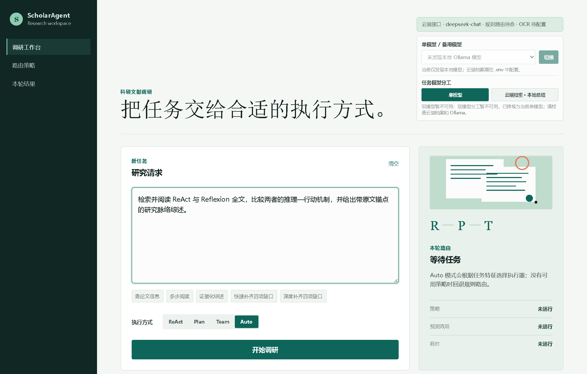
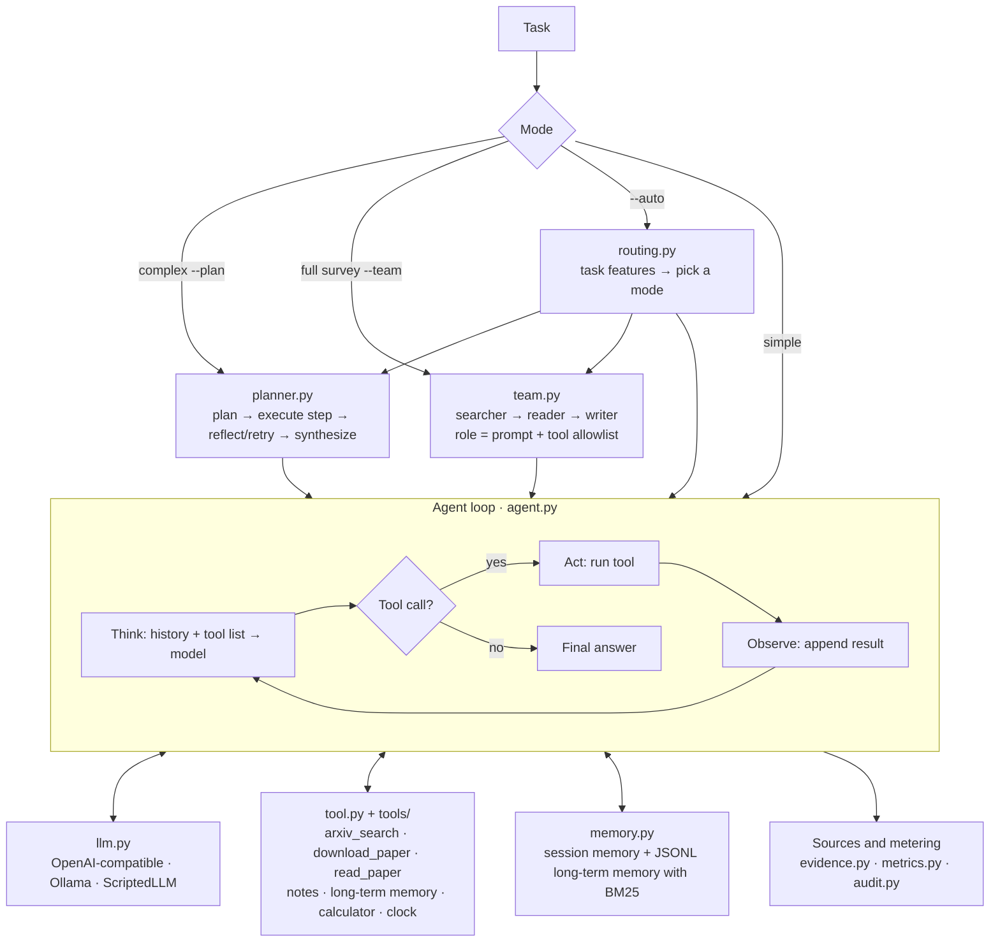

# ScholarAgent

**A research-literature agent built from scratch.** It supports three execution
modes (ReAct, plan–execute–reflect, and a multi-role team), can pick a mode
automatically based on the task, and records every tool call, token cost and
the source behind each conclusion.

[](https://github.com/jian-in/ScholarAgent/actions/workflows/ci.yml)


[](https://github.com/astral-sh/ruff)
[](LICENSE)

English · [中文](README.md)



The workbench UI and the detailed docs are in Chinese; the CLI, the code and
this page work without them.

## Features

**Three execution modes**
- **ReAct**: think → call a tool → observe, until there is an answer. Good for simple tasks.
- **Plan**: plan first, then execute step by step with reflection and retries, then synthesize.
- **Team**: a searcher → reader → writer pipeline; each role only gets its own tools.
- **`--auto`**: picks a mode from task features and explains why.

**Literature tools**
- arXiv search (falls back to OpenAlex when arXiv is busy), PDF download and chunked reading.
- Automatic OCR for scanned PDFs.
- Research notes and long-term memory (JSONL + hand-written BM25).

**Doesn't run away**
- Step limits, a per-step tool-call cap and a per-run character budget.
- LLM timeouts with exponential-backoff retries, tool timeouts, and a circuit
  breaker for repeated tool failures.
- When the budget runs out, it hands back a partial report saying what it got
  and what is missing, instead of just failing.

**Costs you can see**
- Each run records LLM calls, tool calls, latency, tokens, cache hits and the
  cost reported by the provider.
- Oversized tool results are trimmed once, when created, and history is
  append-only, so provider-side prefix caching keeps hitting.

**Conclusions with sources**
- The paper reader emits page-level source IDs, and every conclusion in the
  final answer is expected to cite one.
- Missing citations, wrong citations and quotes that don't match the source are flagged.
- Paper versions can be pinned so the agent doesn't read the wrong version.

**Also**
- No LangChain or similar framework; only 4 runtime dependencies.
- A local web workbench to switch modes and models (Ollama or any
  OpenAI-compatible API) and view the event timeline and artifacts.

## Quick start

```bash
python -m venv .venv
# Windows: .venv\Scripts\...   ·   macOS/Linux: .venv/bin/...
.venv/bin/python -m pip install -e ".[dev]"

.venv/bin/scholaragent --demo          # offline demo, no API key needed
.venv/bin/scholaragent-web --open      # local workbench at http://127.0.0.1:8765
```

For real use, copy `.env.example` to `.env` and fill in an OpenAI-compatible
base URL, key and model, or run Ollama locally (used automatically when no key
is configured).

```bash
scholaragent --plan "Survey the core idea of the ReAct paper and take notes"
scholaragent --team "Memory mechanisms of LLM agents"
scholaragent --auto "Read the full texts of three papers, compare them, and write a survey"
```

A prebuilt wheel is attached to each [release](https://github.com/jian-in/ScholarAgent/releases).

## Architecture



The model only decides which tool to call; execution and boundary checks are
done by the program. Tool errors go back to the model so it can correct itself
instead of crashing. A scripted fake model (`ScriptedLLM`) lets every test and
demo run offline at zero cost.

## Testing

```bash
.venv/bin/python -m pytest -q
```

- 390+ offline tests cover the agent loop, tools, memory, planning, the team
  pipeline, routing, metrics and the workbench. They use the fake model, so no
  network and no API cost.
- CI runs tests and ruff on Windows and Ubuntu × Python 3.10–3.12 and
  smoke-tests the built wheel in a clean environment.
- The project has also been run on 12 literature tasks × 3 modes with a real
  model, which surfaced and fixed 3 issues that only show up against real
  providers (see [CHANGELOG.md](CHANGELOG.md)).

## Contributing and license

Issues and PRs are welcome; see [CONTRIBUTING.md](CONTRIBUTING.md) and
[SECURITY.md](SECURITY.md). Licensed under the [MIT License](LICENSE).
