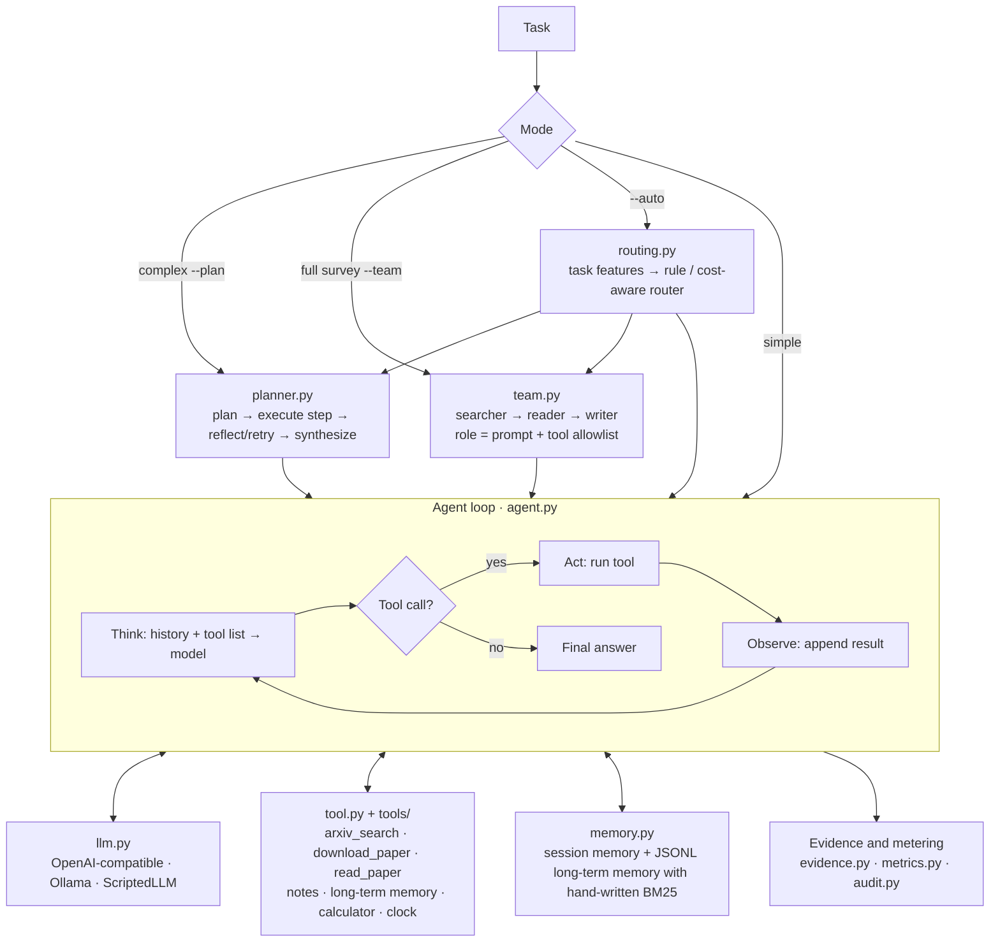

# ScholarAgent

**A research-literature agent built from scratch: three execution modes (ReAct,
plan–execute–reflect, and a multi-role team), automatic routing by task
complexity, and a run record in which every tool call, token count and source
citation can be traced and re-checked.**

[](https://github.com/jian-in/ScholarAgent/actions/workflows/ci.yml)


[](https://github.com/astral-sh/ruff)
[](LICENSE)

English · [中文](README.md)


## Why

What hurts most in research is not a slow answer but an unreliable one: an
agent that runs away and won't stop, a cost nobody can account for, or a
conclusion that looks right but has no traceable source. ScholarAgent treats
these as engineering problems and uses literature research as the proving
ground. The whole framework is hand-written, with no LangChain or similar
orchestration wrappers and only 4 runtime dependencies, so every layer can be
read and tested.

The workbench UI and the detailed docs are currently in Chinese; the CLI, the
code and this page work without them.

## How reliability is enforced

| Question | Mechanism | Tests |
|---|---|---|
| **Can it run away?** | Step fuse (including the closing step), per-step tool-call cap and per-run character budget; LLM timeouts with exponential-backoff retries; per-call tool timeout and a circuit breaker for consecutive failures; a cooperative soft timeout shared by the CLI and the web UI; tool errors go back to the model instead of crashing; when the budget runs out, a partial report is kept and marked as partial | `test_budget_caps.py` `test_llm_retry.py` `test_tool_timeout.py` `test_batch2_fixes.py` `test_completion_evidence.py` |
| **What did it cost?** | Each run records real LLM calls, request attempts, tool calls, latency and provider-reported tokens (including cache hits); missing usage is recorded as unknown, never estimated. Oversized tool results are trimmed once, when created, and history is append-only, so the prompt prefix stays byte-stable and prefix caching keeps hitting | `test_metrics.py` `test_runtime_metrics.py` `test_context_compression.py` |
| **Is the conclusion backed?** | The paper reader emits page and paragraph anchors. Each line of the final answer is logged in a claim–evidence ledger; uncited lines, unknown citations and quotes that don't match the source are flagged, and model output is never auto-marked as verified. Paper versions can be pinned. Scanned PDF pages go through OCR with downgraded confidence | `test_completion_evidence.py` `test_pinned_sources.py` `test_artifact_audit.py` `test_ocr.py` |
| **Which mode should run?** | `--auto` extracts versioned task features and picks ReAct, Plan or Team, recording features, reasons and policy version. A missing or corrupt learned policy falls back to the rule-based router | `test_routing.py` `test_cost_aware_routing.py` |

All of this is covered by **390+ offline tests** that run against a scripted
fake model (`ScriptedLLM`), with no network access and no API spend. CI covers
Windows and Ubuntu × Python 3.10–3.12 and smoke-tests the built wheel in a clean
virtual environment.

## Quick start

```bash
python -m venv .venv
# Windows: .venv\Scripts\...   ·   macOS/Linux: .venv/bin/...
.venv/bin/python -m pip install -e ".[dev]"

.venv/bin/scholaragent --demo          # offline demo, no API key needed
.venv/bin/scholaragent-web --open      # local workbench at http://127.0.0.1:8765
.venv/bin/python -m pytest -q          # full offline test suite
```

For real tasks, copy `.env.example` to `.env` and configure an
OpenAI-compatible endpoint (DeepSeek, Qwen, etc.), or run a local Ollama model,
which is used automatically when no API key is configured.

```bash
scholaragent --plan "Survey the core idea of the ReAct paper and take notes"
scholaragent --team "Memory mechanisms of LLM agents"
scholaragent --auto "Read the full texts of three papers, compare them, and write a survey"
```

A prebuilt wheel is attached to each [release](https://github.com/jian-in/ScholarAgent/releases).

## Architecture



## Current evidence and limitations

- The offline tests verify engineering behavior and regression boundaries.
  They do **not** show that answers to real literature tasks reach any given
  accuracy.
- One public real-world case study is available: a survey of the ReAct paper,
  run in all three modes, with answers, trajectory summaries, metrics and
  preliminary scores. See [`docs/case-study.md`](docs/case-study.md) and
  `evals/case_results/react-method-evidence-v1/`. Those scores are the
  author's preliminary self-assessment.
- A 12-task fixed-version task set, a 3-task pilot manifest and a blind-review
  pipeline are in place. The real runs and independent scoring are still
  pending. See [`docs/research-validation.md`](docs/research-validation.md).
- The router, calibration, training and held-out evaluation scripts are
  implemented. A formal cost comparison has **not** been produced yet, and no
  claim is made that the learned router beats the rule baseline.

## Documentation (Chinese)

| Doc | Contents |
|---|---|
| [Usage guide](docs/usage.md) | Install, run modes, local workbench, model switching |
| [Capabilities and design](docs/features.md) | Design principles, full feature list, comparison, repo layout |
| [Cost-aware routing](docs/routing.md) | Features, reward model, training and evaluation commands |
| [Context cost control](docs/context-cost.md) | Finalize-at-creation pruning and prefix caching |
| [Research validation](docs/research-validation.md) | Stop semantics, evidence chain, task set, blind review |
| [Roadmap](docs/ROADMAP.md) · [Changelog](CHANGELOG.md) | Plans and release history |
| [Archive](archive/) | Untrained fine-tuning scaffold, contest materials, early plans |

## Contributing

See [CONTRIBUTING.md](CONTRIBUTING.md) and [SECURITY.md](SECURITY.md).
Licensed under the [MIT License](LICENSE).
