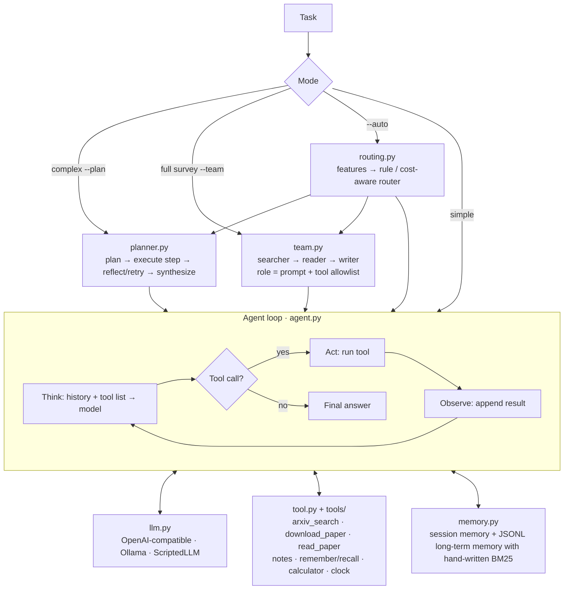

# ScholarAgent

**A research-literature agent built from scratch: three execution modes (ReAct,
plan–execute–reflect, and a multi-role team), automatic routing by task
complexity, and a run record in which every tool call, token count and source
citation can be traced and re-checked.**

[](https://github.com/jian-in/ScholarAgent/actions/workflows/ci.yml)


[](https://github.com/astral-sh/ruff)
[](LICENSE)

English · [中文](README.md)


ScholarAgent is a transparent test bench for agent engineering. Besides the
final answer, it keeps the execution path, the differences between modes,
quality scores, latency and call cost, so that runs can be reproduced and
compared. The workbench UI is currently in Chinese; the CLI, code and this
document are usable without it.

## Highlights

- **No orchestration framework.** The model layer, tool layer, ReAct loop,
  memory, planner and multi-agent pipeline are hand-written, with no LangChain or
  similar wrappers. Only 4 runtime dependencies; the core ReAct loop is about
  200 lines.
- **Three modes plus explainable routing.** `--auto` extracts versioned task
  features and picks ReAct, Plan or Team. Every decision records its features,
  reasons and policy version. If a learned policy is missing or corrupt, the
  router falls back to the rule-based baseline.
- **Cost guardrails.** Older tool observations are compressed before each call
  (in an offline paper-reading run, the context sent to the model drops below
  50% of the uncompressed size). There are also a per-step tool-call cap, a
  per-run character budget, LLM timeouts with exponential-backoff retries, a
  circuit breaker for consecutive tool failures, and a cooperative soft timeout
  shared by the CLI and the web UI.
- **Evidence over plausibility.** The paper reader emits page and paragraph
  anchors. Each claim in the final answer is logged in a claim–evidence ledger,
  and uncited lines, unknown citations and quotes that do not match the source
  are all flagged. Pages of scanned PDFs are run through OCR automatically, and
  their evidence confidence is downgraded.
- **Honest cost accounting.** Each run records real LLM calls, request
  attempts, tool calls, latency and the token usage reported by the provider.
  When the provider returns no usage, tokens are recorded as unknown rather than
  estimated.
- **Engineering quality.** 390+ offline tests run against a scripted fake model
  (`ScriptedLLM`), with no network access and no API spend. CI covers Windows
  and Ubuntu × Python 3.10–3.12 and smoke-tests the built wheel in a clean
  virtual environment. Linting uses ruff.
- **Local workbench.** Built on the standard-library `http.server` and vanilla
  JS. It switches modes and models (local Ollama or any OpenAI-compatible cloud
  endpoint), can split work between models (cloud model for retrieval and tool
  decisions, local model for summaries), and shows the event timeline,
  artifacts and replays of saved cases.

## Quick start

```bash
python -m venv .venv
# Windows: .venv\Scripts\python   ·   macOS/Linux: .venv/bin/python
.venv/bin/python -m pip install -e ".[dev]"

# Offline demo with a scripted model: no API key needed
.venv/bin/scholaragent --demo

# Local workbench at http://127.0.0.1:8765
.venv/bin/scholaragent-web --open

# Full offline test suite
.venv/bin/python -m pytest -q
```

For real research tasks, copy `.env.example` to `.env` and configure an
OpenAI-compatible endpoint (DeepSeek, Qwen, etc.), or run a local Ollama model.
When no API key is configured and Ollama is running, a local model is used
automatically.

```bash
scholaragent "What time is it? Also compute 365*24"
scholaragent --plan "Survey the core idea of the ReAct paper and take notes"
scholaragent --team "Memory mechanisms of LLM agents"
scholaragent --auto "Read the full texts of three papers, compare them, and write a survey"
```

## Architecture



Design principles:

1. **The model decides; the program enforces boundaries.** The model only emits
   tool names and arguments. Search, download, reading, computation and memory
   writes are done by Python tools. Tool errors go back to the model as text so
   it can correct itself, instead of crashing the run.
2. **Layer complex tasks.** Simple tasks use the ReAct loop directly. Complex
   tasks are planned, executed step by step and reflected on. Full surveys go
   through a three-role pipeline.
3. **Everything is verifiable offline.** `ScriptedLLM` makes tests and demos
   free and deterministic.

## Cost-aware routing

The learned router fits an offline ridge-regression reward model for each mode:

```text
reward = quality
         - lambda_time  * normalized_latency
         - lambda_calls * normalized_llm_calls
         - lambda_token * normalized_tokens
```

Training makes no model calls. If `lambda_token` is non-zero, observations
without provider-reported tokens are rejected rather than estimated. The rule
router's complexity labels can be checked on a fixed 36-task set with zero model
calls:

```bash
python evals/evaluate_rule_router.py --tasks evals/router_tasks.jsonl --output-dir evals/results/rule_routing
```

## Current evidence and limitations

- The offline tests verify engineering behavior and regression boundaries.
  They do **not** show that answers to real literature tasks reach any given
  accuracy.
- One public real-world case study is available: a survey of the ReAct paper,
  run in all three modes, with answers, trajectory summaries, metrics and
  preliminary scores. See [`docs/case-study.md`](docs/case-study.md) and
  `evals/case_results/react-method-evidence-v1/`. Those scores are the
  author's preliminary self-assessment.
- A 12-task fixed-version task set, a 3-task pilot manifest and a blind-review
  pipeline are in place. The real runs and independent scoring are still
  pending. See [`docs/research-validation.md`](docs/research-validation.md).
- The router, calibration, training and held-out evaluation scripts are
  implemented. A formal cost comparison has **not** been produced yet, and no
  claim is made that the learned router beats the rule baseline.

## Repository layout

```text
main.py            CLI: interactive / one-shot / --plan / --team / --auto / --demo
webapp.py          Local workbench server (standard library, 127.0.0.1 only)
web/               Workbench front end (vanilla JS)
scholaragent/      Core package: llm, tool(s), agent, memory, planner, team,
                   routing, metrics, evidence, audit, ocr, runtime, workspace
evals/             Task sets, experiment manifests, evaluation and review entry points
tests/             Offline test suite (no network, no API cost)
docs/              Architecture notes, case study, validation plan, roadmap
finetune/          Optional QLoRA fine-tuning scaffold
```

## Contributing

See [CONTRIBUTING.md](CONTRIBUTING.md), [SECURITY.md](SECURITY.md) and
[docs/ROADMAP.md](docs/ROADMAP.md). Licensed under the [MIT License](LICENSE).
