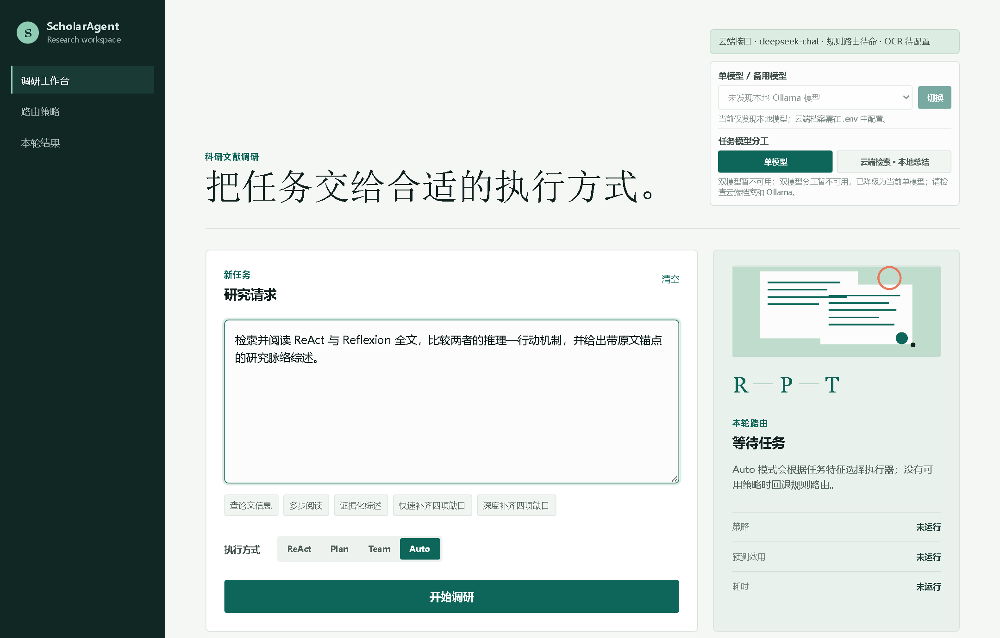
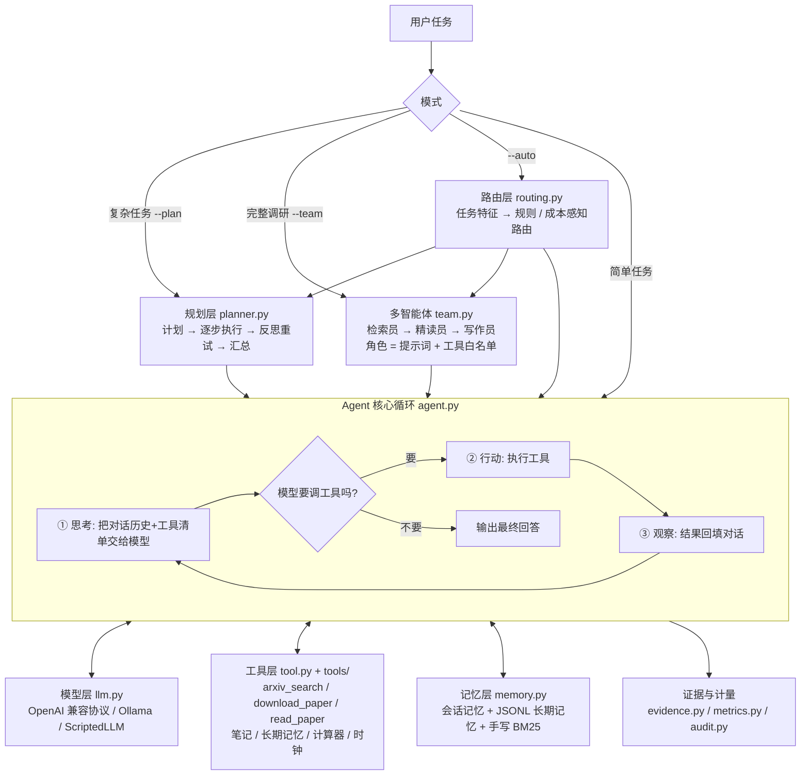

# ScholarAgent

**从零实现的科研文献调研 Agent：ReAct / 计划—执行—反思 / 多角色协作三种执行模式，
按任务复杂度自动路由，每一步工具调用、token 成本和原文证据都可追溯、可复验。**

> 面向科研文献调研的开源 **Agent 工程的透明实验台**：不仅展示最终回答，
> 还保留执行路径、模式差异、质量评分、耗时与调用成本，便于复现和比较。

[](https://github.com/jian-in/ScholarAgent/actions/workflows/ci.yml)


[](https://github.com/astral-sh/ruff)
[](LICENSE)

[English](README.en.md) · 中文



## 为什么做这个

调研最怕的不是答得慢，而是答得不可靠：Agent 跑飞了停不下来、成本说不清、
结论看着对却找不到出处。ScholarAgent 把这三件事当成工程问题来解决，
文献调研是检验它们的场景。整个框架从零手写，不依赖 LangChain 等编排封装，
运行时只有 4 个依赖，每一层都能看清、能测试。

## 可靠性怎么保证

| 问题 | 机制 | 复验入口 |
|---|---|---|
| **会不会跑飞** | 步数保险丝（含收尾步）、每步工具调用上限、单轮字符预算；LLM 超时 + 指数退避重试；工具单次超时与连续失败熔断；CLI/Web 共用协作式软超时；工具报错回传模型纠错而不是崩溃；预算耗尽时保留阶段报告并标注完整度 | `test_budget_caps.py` `test_llm_retry.py` `test_tool_timeout.py` `test_batch2_fixes.py` `test_completion_evidence.py` |
| **花了多少钱** | 每次运行记录真实 LLM 调用、请求尝试、工具调用、耗时和服务返回的 token（含缓存命中），没返回就记为未知、不估算；超长工具结果定稿式裁剪，历史只追加、前缀稳定，让前缀缓存全程命中 | `test_metrics.py` `test_runtime_metrics.py` `test_context_compression.py` |
| **结论有没有依据** | 论文阅读输出页码/段落锚点；最终回答逐行登记到主张—证据账本，未引用、引错、摘录不匹配都会标出，模型产出不会自动变成“已核验”；固定论文版本约束；扫描版 PDF 自动 OCR 并降低置信度 | `test_completion_evidence.py` `test_pinned_sources.py` `test_artifact_audit.py` `test_ocr.py` |
| **该用哪种执行方式** | `--auto` 提取版本化任务特征，在 ReAct / Plan / Team 间选择，每次决策附特征、理由和策略版本；学习策略缺失或损坏时安全回退规则路由 | `test_routing.py` `test_cost_aware_routing.py` |

以上全部由 **390+ 项离线测试**覆盖：测试使用脚本化假模型 `ScriptedLLM`，不联网、不花钱，
CI 在 Windows/Ubuntu × Python 3.10–3.12 上运行，并在干净环境安装 wheel 做冒烟测试。

## 快速开始

```powershell
python -m venv .venv
.venv\Scripts\python -m pip install -e ".[dev]"

.venv\Scripts\scholaragent --demo          # 离线演示，不需要 API Key
.venv\Scripts\scholaragent-web --open      # 本地工作台 http://127.0.0.1:8765
.venv\Scripts\python -m pytest -q          # 全部离线测试
```

真实调研需要把 `.env.example` 复制为 `.env` 并配置 OpenAI 兼容接口（DeepSeek、千问等），
或者在本机运行 Ollama（没有配置 Key 时自动使用本地模型）。

```powershell
scholaragent --plan "调研 ReAct 论文的核心思想并记笔记"
scholaragent --team "LLM agent 的记忆机制"
scholaragent --auto "检索并阅读全文，比较三篇论文，撰写研究脉络综述"
```

也可以下载 [Release](https://github.com/jian-in/ScholarAgent/releases) 中的 wheel 直接安装。
更多运行方式、工作台和模型配置见 [使用指南](docs/usage.md)。

## 系统架构



## 当前证据与边界

- 仓库包含 **390+ 项离线测试**，覆盖 Agent 循环、工具、记忆、规划、团队模式、
  路由、指标、启动脚本和本地工作台；可用 `python -m pytest -q` 复验。
- 离线测试证明的是工程行为和回归边界，不等于真实文献任务的答案质量已经达到
  某个固定准确率。
- 已公开第一个可复验真实案例：ReAct 论文文献调研在 ReAct/Plan/Team 三模式下的
  真实运行（回答、轨迹摘要、指标与初步评分），见 [`docs/case-study.md`](docs/case-study.md)
  与 `evals/case_results/react-method-evidence-v1/`。该案例评分为作者初步自评。
- 已准备 12 题固定版本任务、3 题试跑清单及离线盲评入口，真实运行和独立评分仍待执行，
  见 [`docs/research-validation.md`](docs/research-validation.md)。
- 路由器、校准、训练和留出集评测入口已经实现，规则路由可在固定 36 题上零模型调用复验；
  完整校准评分和留出集报告仍待完成，**尚未产出正式成本对比结论**。

## 文档

| 文档 | 内容 |
|---|---|
| [使用指南](docs/usage.md) | 安装、运行模式、本地工作台、模型切换与双模型分工 |
| [能力与设计](docs/features.md) | 设计理念、完整能力清单、与同类工具对比、目录结构 |
| [成本感知自适应路由](docs/routing.md) | 特征、奖励模型、训练与评测命令 |
| [上下文成本控制](docs/context-cost.md) | 定稿式裁剪与前缀缓存 |
| [真实任务验证](docs/research-validation.md) | 停止语义、证据链、固定任务集与盲评流程 |
| [案例研究](docs/case-study.md) · [演示指南](docs/demo-guide.md) | 公开真实案例与五分钟演示路径 |
| [架构专题](docs/architecture/) | OCR、模型分工与超时、token 统计、资料缺口调研 |
| [路线图](docs/ROADMAP.md) · [更新日志](CHANGELOG.md) | 计划与版本变更 |
| [归档](archive/) | 未训练的微调脚手架、参赛材料、早期实施计划 |

## 开源治理

[MIT License](LICENSE) · [贡献指南](CONTRIBUTING.md) · [安全报告](SECURITY.md) ·
[行为准则](CODE_OF_CONDUCT.md) · [维护说明](MAINTAINERS.md)

运行时依赖（openai、python-dotenv、httpx、pypdf）均为 MIT 或 Apache-2.0 许可证。
欢迎通过 Issue 提交可复现的问题或使用场景；代码修改请附测试命令和结果。
