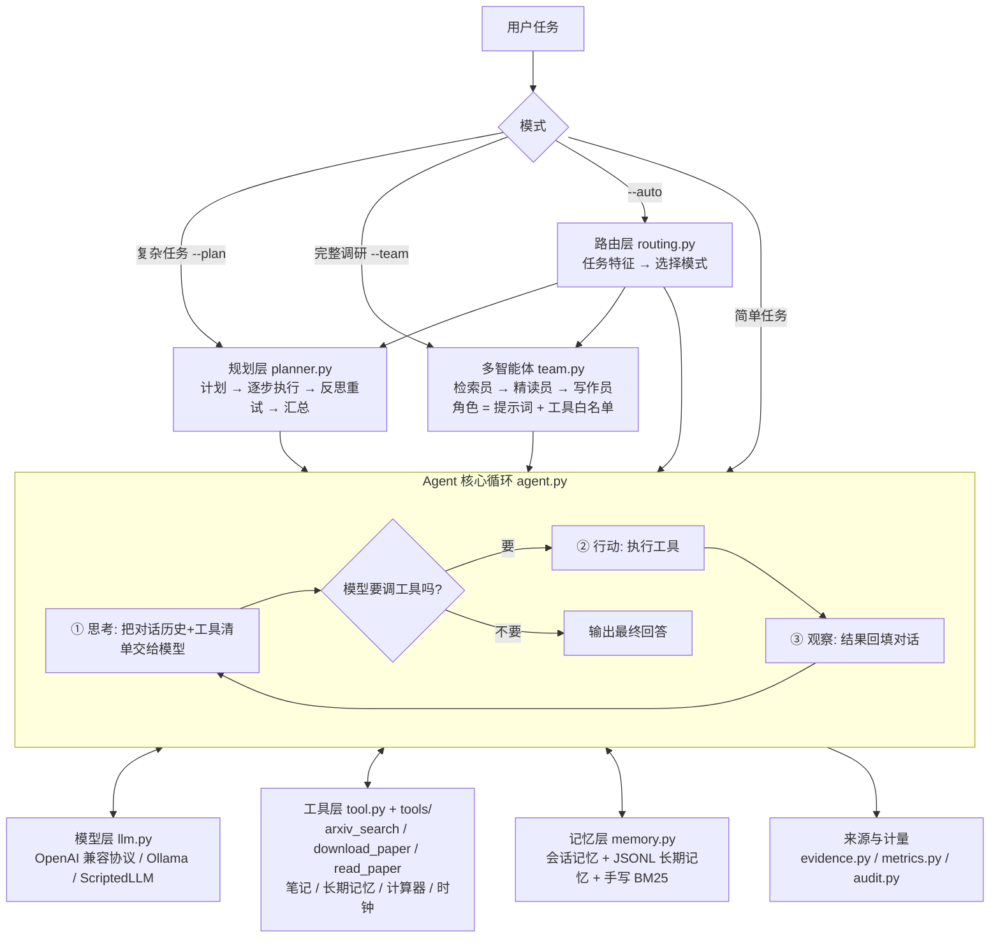

# ScholarAgent

**从零实现的科研文献调研 Agent。** 支持 ReAct、计划—执行—反思、多角色协作三种执行模式，
可以按任务复杂度自动选择；每一步工具调用、token 花费和结论出处都有记录可查。

[](https://github.com/jian-in/ScholarAgent/actions/workflows/ci.yml)


[](https://github.com/astral-sh/ruff)
[](LICENSE)

[English](README.en.md) · 中文


## 特性

**三种执行模式**
- **ReAct**：思考 → 调用工具 → 观察结果，循环到得出答案，适合简单任务。
- **Plan**：先拆计划，再逐步执行、反思、重试，最后汇总，适合多步骤任务。
- **Team**：检索员 → 精读员 → 写作员流水线，每个角色只能用自己的工具，适合完整调研。
- **`--auto`**：根据任务特征自动选模式，并说明选择理由。

**文献工具**
- arXiv 检索（官方接口繁忙时自动改用 OpenAlex），PDF 下载与分段阅读。
- 下载论文时附带目录（章节 → 页码），可以按章节跳读；也能在论文里按关键词检索，直接拿到相关原文段落（复用自研 BM25）。
- 扫描版 PDF 自动 OCR。
- 研究笔记和长期记忆（JSONL + 手写 BM25 检索）。

**不会跑飞**
- 步数上限、每步工具调用上限、单次运行的字符预算。
- LLM 超时 + 指数退避重试，工具超时，工具连续失败自动熔断。
- 预算用完时不会直接报错，而是交出一份写清楚“拿到了什么、缺了什么”的阶段报告。

**花费看得见**
- 每次运行记录 LLM 调用次数、工具调用次数、耗时、token、缓存命中，以及服务返回的实际花费。
- 超长的工具结果在产生时一次性裁剪，历史只追加不改写，让模型服务的前缀缓存一直命中，省钱。

**结论有出处**
- 读论文时生成带页码的来源编号，最终回答的每条结论都要标注来源。
- 没标来源、标错来源、引文和原文对不上，都会被标出来。
- 可以固定论文版本，避免读错版本。

**其他**
- 不依赖 LangChain 等框架，运行时只有 4 个依赖。
- 本地网页工作台：切换模式和模型（Ollama 或任意 OpenAI 兼容接口），查看事件时间线和产物。
- 支持 DeepSeek、千问等 OpenAI 兼容接口，也支持本地 Ollama。

## 快速开始

```powershell
python -m venv .venv
.venv\Scripts\python -m pip install -e ".[dev]"

.venv\Scripts\scholaragent --demo          # 离线演示，不需要 API Key
.venv\Scripts\scholaragent-web --open      # 本地工作台 http://127.0.0.1:8765
```

真实使用时，把 `.env.example` 复制为 `.env` 并填上 OpenAI 兼容接口的地址、Key 和模型名，
或者在本机运行 Ollama（没配置 Key 时会自动使用本地模型）。

```powershell
scholaragent "现在几点了？顺便算一下 365*24"
scholaragent --plan "调研 ReAct 论文的核心思想并记笔记"
scholaragent --team "LLM agent 的记忆机制"
scholaragent --auto "检索并阅读全文，比较三篇论文，撰写研究脉络综述"
```

也可以直接下载 [Release](https://github.com/jian-in/ScholarAgent/releases) 里的 wheel 安装。
更多用法见 [使用指南](docs/usage.md)。

## 架构



设计上就三条：模型只决定调用什么工具，真正的执行和边界检查都由程序负责；
工具出错时把错误信息交还给模型，让它自己纠正，程序不崩；
用假模型 `ScriptedLLM` 让所有测试和演示都能离线运行、零成本。

## 测试

```powershell
.venv\Scripts\python -m pytest -q
```

- 390+ 项离线测试，覆盖 Agent 循环、工具、记忆、规划、多智能体、路由、指标和工作台。
  测试使用假模型，不联网、不花钱。
- CI 在 Windows / Ubuntu × Python 3.10–3.12 上跑测试和 ruff 检查，并在干净环境里安装 wheel 试运行。
- 另外用真实模型（`deepseek-v4.1-flash`）跑过 12 道文献任务 × 3 种模式，共 36 次，**没有一次失败或崩溃**；
  过程中修掉了 3 个只有真实环境才会出现的问题（见 [更新日志](CHANGELOG.md)）。

| 模式 | 结果完整 | 中位耗时 | 平均花费（估算） |
|---|---:|---:|---:|
| ReAct | 8 / 12 | 52 秒 | $0.04 |
| Plan | 3 / 12 | 4.6 分钟 | $0.19 |
| Team¹ | 1 / 12 | 2.4 分钟 | $0.12 |

没完整的运行都是步数用完，系统按设计交出了阶段报告。每题只跑一次，回答质量没有人工打分；
花费按市场单价估算、偏高。¹ Team 为修复前的数据，当时精读员会把步数用光，已修复但未重跑。
详见 [实验结果](docs/experiments/research-full-v1.md)，做法见 [真实任务实验](docs/research-validation.md)。

## 文档

| 文档 | 内容 |
|---|---|
| [使用指南](docs/usage.md) | 安装、运行模式、本地工作台、模型切换 |
| [功能与设计](docs/features.md) | 完整功能清单、与同类工具对比、目录结构 |
| [自动路由](docs/routing.md) | `--auto` 怎么选模式 |
| [上下文成本控制](docs/context-cost.md) | 裁剪策略与前缀缓存 |
| [真实任务实验](docs/research-validation.md) | 怎么用真实模型跑一批任务、看结果 |
| [案例研究](docs/case-study.md) | 一次公开的三模式真实运行记录 |
| [架构专题](docs/architecture/) | OCR、模型分工与超时、token 统计、资料缺口调研 |
| [路线图](docs/ROADMAP.md) · [更新日志](CHANGELOG.md) | 计划与版本变更 |

## 贡献与许可

欢迎提 Issue 和 PR，流程见 [CONTRIBUTING.md](CONTRIBUTING.md)，安全问题见 [SECURITY.md](SECURITY.md)。
本项目使用 [MIT License](LICENSE)。
