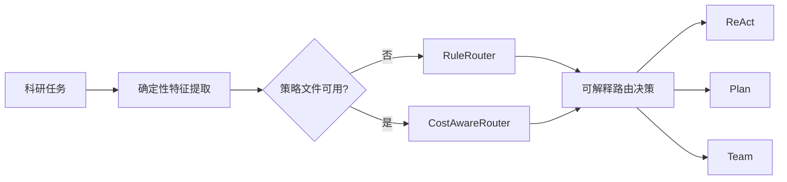

# 成本感知自适应路由

> **状态**：规则路由、特征提取、学习路由的训练与评测入口均已实现，规则路由可零模型调用复验。
> 学习路由的校准评分、策略训练和留出集正式对比**已暂停**（见 [路线图](ROADMAP.md)），
> 因此本文不声明学习路由优于规则路由。

`--auto` 是显式启用的第四种入口，不会改变默认 ReAct、`--plan` 或 `--team`
的行为。它先从任务文字提取版本化的本地特征，再在三种执行模式间选择：



特征包括任务长度、行动目标数、文献检索、全文阅读、多论文比较、综述、记忆
和约束依赖，以及偏置项。训练和推理固定使用 `task-features-v1` 的名称和顺序。
规则路由用于冷启动；学习路由对每个模式拟合离线岭回归奖励模型：

```text
reward = quality
         - lambda_time  * normalized_latency
         - lambda_calls * normalized_llm_calls
         - lambda_token * normalized_tokens
```

API 未返回 token 时指标为 `None`。当 `lambda_token` 非零，训练会拒绝这类
观测，不会估算 token。策略缺失、损坏或特征版本不匹配时，`--auto` 会打印原因并
安全回退到 `RuleRouter`。

```powershell
# 自动路由；没有 data/router/policy.json 时使用规则路由
.venv\Scripts\python main.py --auto "检索并阅读全文，比较三篇论文，撰写研究脉络综述"

# 零模型调用评估规则路由
.venv\Scripts\python evals\evaluate_rule_router.py --tasks evals\router_tasks.jsonl --output-dir evals\results\rule_routing

# 先在固定校准集上运行三种模式，原始文件不得覆盖
.venv\Scripts\python evals\calibrate_router.py --output evals\results\router_calibration.jsonl

# 人工完成独立评分表后训练策略；训练不会调用模型
.venv\Scripts\python evals\train_router.py --observations evals\results\router_calibration.jsonl --scores evals\results\router_scores.jsonl

# 留出集正式比较：五种策略、两项主消融和可选成本敏感性策略
.venv\Scripts\python evals\run_routing_eval.py --policy data\router\policy.json --quality-only-policy data\router\policy_quality_only.json --global-policy data\router\policy_global.json --sensitivity-policy low_time=data\router\policy_low_time.json --sensitivity-policy high_time=data\router\policy_high_time.json
```

正式报告同时保留 JSONL 原始回答、质量、耗时、LLM/工具调用、token、路由混淆矩阵
和每题理由。质量由独立人工评分表按任务完成、事实正确性、引用有效性和输出完整性
加权；未评分数据会明确标记为“未评分”，不纳入质量结论。

实验清单也可以生成不可覆盖的证据包与 Markdown 汇总；下面是完全离线的示例：

```powershell
.venv\Scripts\python evals\run_experiment.py `
  --manifest evals\experiments\offline_demo.json `
  --output evals\results\offline-demo-v1
```

清单运行会把公开证据与 `<output>.state` 私有工作区分开；目标目录已存在时拒绝重跑覆盖。
