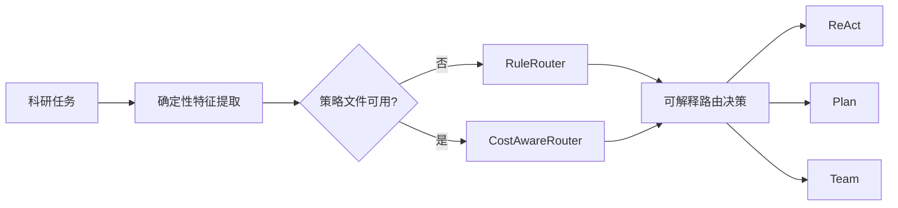

# 成本感知自适应路由

> **状态**：规则路由可以直接用，也能不调用模型就复查它的判断。学习路由的代码和脚本都在，
> 但完整实验已暂停（见 [路线图](ROADMAP.md)），所以不声称它比规则路由更好。

`--auto` 是显式启用的第四种入口，不会改变默认 ReAct、`--plan` 或 `--team`
的行为。它先从任务文字提取版本化的本地特征，再在三种执行模式间选择：



特征包括任务长度、行动目标数、文献检索、全文阅读、多论文比较、综述、记忆
和约束依赖，以及偏置项。训练和推理固定使用 `task-features-v1` 的名称和顺序。
规则路由用于冷启动；学习路由对每个模式拟合离线岭回归奖励模型：

```text
reward = quality
         - lambda_time  * normalized_latency
         - lambda_calls * normalized_llm_calls
         - lambda_token * normalized_tokens
```

服务没返回 token 时记为 `None`；`lambda_token` 不为 0 时，这类数据不参与训练，
也不会被估算补上。策略文件缺失、损坏或版本对不上时，`--auto` 会打印原因，
改用规则路由。

```powershell
# 自动路由；没有 data/router/policy.json 时使用规则路由
.venv\Scripts\python main.py --auto "检索并阅读全文，比较三篇论文，撰写研究脉络综述"

# 不调用模型，检查规则路由在 36 道题上的判断
.venv\Scripts\python evals\evaluate_rule_router.py --tasks evals\router_tasks.jsonl --output-dir evals\results\rule_routing

# 以下是学习路由的实验脚本（已暂停，仍可运行）
# 1. 在一组任务上分别跑三种模式，收集数据
.venv\Scripts\python evals\calibrate_router.py --output evals\results\router_calibration.jsonl

# 2. 给结果打分后训练策略（训练本身不调用模型）
.venv\Scripts\python evals\train_router.py --observations evals\results\router_calibration.jsonl --scores evals\results\router_scores.jsonl

# 3. 在另一组任务上比较几种策略
.venv\Scripts\python evals\run_routing_eval.py --policy data\router\policy.json --quality-only-policy data\router\policy_quality_only.json --global-policy data\router\policy_global.json --sensitivity-policy low_time=data\router\policy_low_time.json --sensitivity-policy high_time=data\router\policy_high_time.json
```

比较报告会保留每道题的原始回答、耗时、调用次数、token、实际选中的模式和理由；
没打分的结果标为“未评分”。

实验清单也可以离线跑一遍示例：

```powershell
.venv\Scripts\python evals\run_experiment.py `
  --manifest evals\experiments\offline_demo.json `
  --output evals\results\offline-demo-v1
```

运行结果和工作区（`<output>.state`）分开存放；输出目录已存在时不会覆盖。
